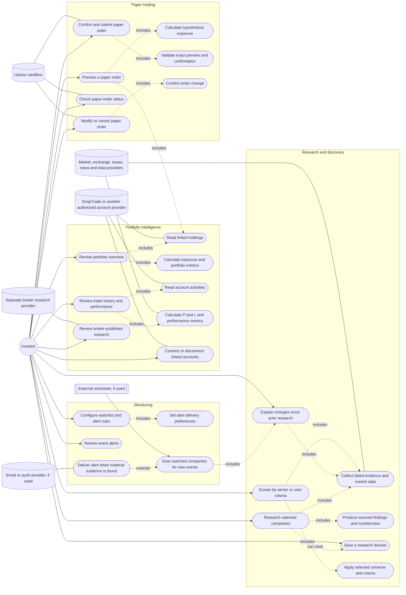
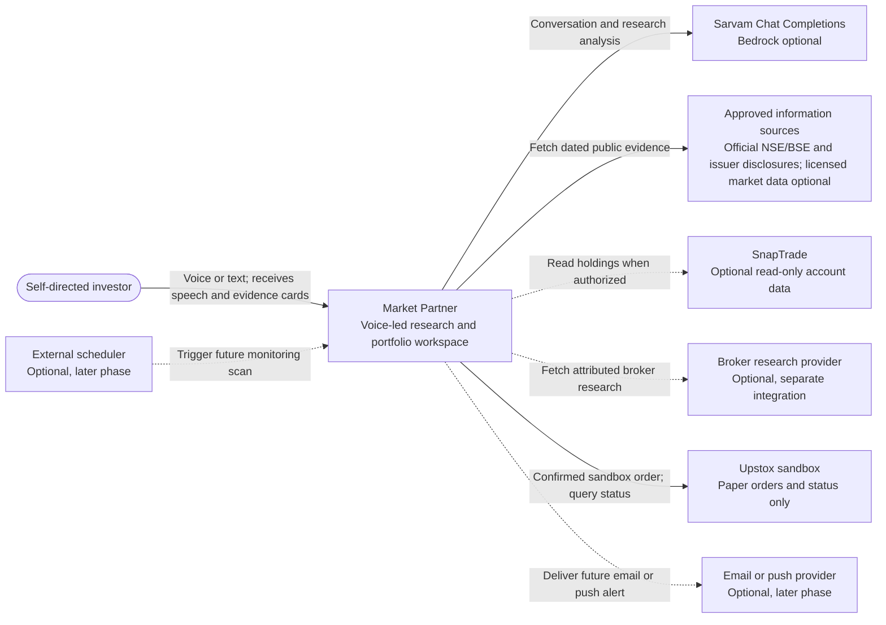
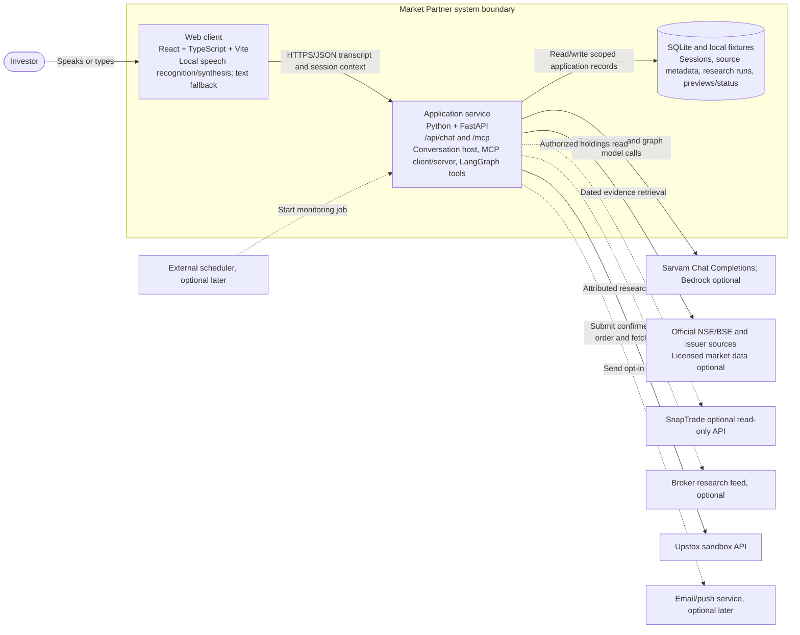
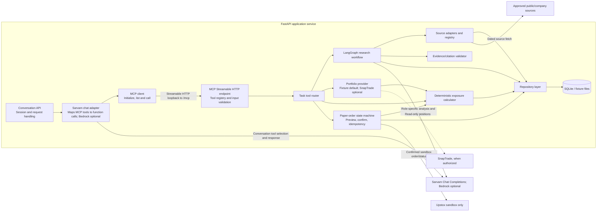
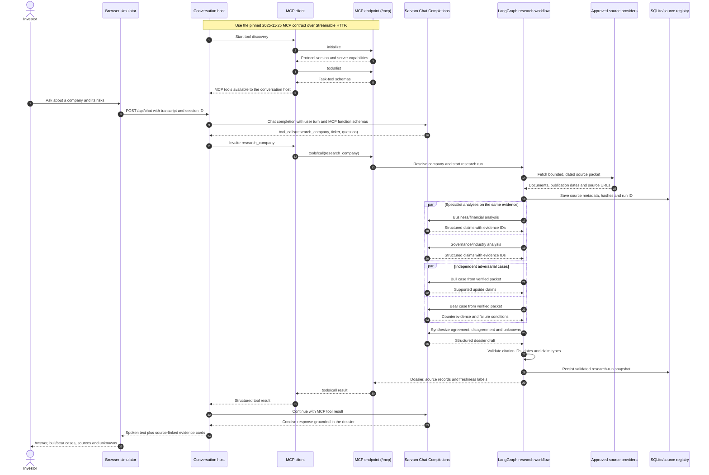
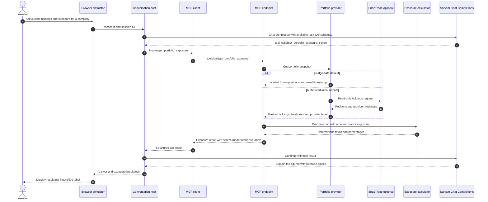

# Market Partner

**A sourced research and portfolio workspace that helps self-directed investors investigate companies, understand exposure, and rehearse user-directed trades.**

Market Partner is a voice-led product concept for Indian equity investors. The full product target has four connected workflows: portfolio intelligence, company research and screening, event monitoring, and sandbox paper trading. This repository implements a complete fixture-first local version of all 30 designed use cases, while leaving integrations that need real credentials, licensing, or provider verification behind explicit gates.

The project is being built for the Alexa+ track of the Build, Ship, Shape Amazon Developer Hackathon. Participants cannot connect a project to a real Alexa+ device, so the submission uses a browser-based Alexa+ style voice and text simulator backed by a self-hosted MCP server. See the [official rules](https://amazonappdev2026.devpost.com/rules) and [FAQ](https://amazonappdev2026.devpost.com/details/faqs).

The conversation and paper-trade interface follows Alexa+ add-on guidance for voice-plus-touch tasks, glanceable cards, and separate confirmations. The [UI research note](docs/ALEXA_PLUS_UI_RESEARCH.md) maps those official design sources to this demo and documents the synthetic-data boundary.

For this track, the integration is a **real Market Partner MCP server**, not a native connection to the Alexa+ service. The web conversation host connects over Streamable HTTP using the pinned 2025-11-25 protocol contract, performs MCP `initialize` and `tools/list`, then invokes tools with `tools/call`. The browser demo uses this runtime path; a mock tool call or a server that is only named in the README would not demonstrate the required technology. The FAQ says the gated Alexa+ developer tools are unavailable to hackathon participants and recommends this self-hosted MCP plus web-simulator approach.

## Product use-case overview



This is the **full product target**, not the hackathon delivery promise. The complete PlantUML source is in [`docs/USE_CASES.puml`](docs/USE_CASES.puml). Sarvam is the current model provider, with Bedrock optional; providers appear in the [system architecture](docs/ARCHITECTURE.md), not as investor-facing actors in this use-case view.

## High-level design (C4)

The diagrams distinguish the full product context from the containers and components used for the hackathon build. Dashed relationships are optional or later-phase paths. The detailed design notes are in [`docs/HLD.md`](docs/HLD.md).

### Level 1 — System context



The “Alexa+” experience here is our browser simulator. We do not connect to a real Alexa+ device or service.

### Level 2 — Containers



The conversation host calls its MCP endpoint over Streamable HTTP, including real `initialize`, `tools/list`, and `tools/call` requests. The browser handles speech recognition and synthesis, then sends recognized text to the backend; model and brokerage credentials stay on the server.

### Level 3 — Application-service components



The conversation model selects task-level tools; it does not do financial arithmetic. The research graph uses the same approved source packet for specialist, bull and bear analysis. Code validates citations, calculates exposure and enforces order state.

### Key sequence diagrams

The first three sequences are the hackathon MVP. The monitoring sequence is a later-phase target and is shown to make the product boundary explicit. These flows are also maintained in the [detailed HLD](docs/HLD.md).

#### Sourced company research (MVP)



#### Review current portfolio exposure (MVP)



#### Preview and explicitly confirm a paper order (MVP)

```mermaid
sequenceDiagram
    autonumber
    actor Investor
    participant Web as Browser simulator
    participant Host as Conversation host
    participant Model as Sarvam Chat Completions
    participant MCPClient as MCP client
    participant MCP as MCP endpoint
    participant Orders as Paper-order service
    participant Calc as Exposure calculator
    participant Store as SQLite order store
    participant Upstox as Upstox sandbox

    Investor->>Web: Provide ticker, side, quantity and limit price
    Web->>Host: Transcript and order details
    Host->>Model: Chat completion with order-tool schemas
    Model-->>Host: tool_calls(preview_paper_order, user-supplied fields)
    Host->>MCPClient: Invoke preview_paper_order
    MCPClient->>MCP: tools/call(preview_paper_order)
    MCP->>Orders: Validate fields and sandbox-only mode
    Orders->>Calc: Calculate estimated value and hypothetical exposure
    Calc-->>Orders: Deterministic preview figures
    Orders->>Store: Save preview ID, exact fields, expiry and idempotency key
    Orders-->>MCP: Preview details; no order submitted
    MCP-->>MCPClient: Preview result
    MCPClient-->>Host: Structured preview result
    Host-->>Web: Show side, instrument, quantity, limit, value and sandbox label
    Web-->>Investor: Ask for separate confirmation

    alt Investor explicitly confirms this exact, unexpired preview
        Investor->>Web: Confirm paper order
        Web->>Host: Confirmation bound to preview ID
        Host->>MCPClient: Invoke confirm_paper_order for this preview
        MCPClient->>MCP: tools/call(confirm_paper_order, preview ID, explicit confirmation)
        MCP->>Orders: Recheck exact fields, expiry, confirmation and idempotency
        Orders->>Store: Atomically claim preview and persist USER_CONFIRMED then SUBMITTING
        Orders->>Upstox: Submit to sandbox only
        alt Sandbox accepts
            Upstox-->>Orders: Sandbox order ID and status
            Orders->>Store: Persist SUBMITTED_SANDBOX and provider observation
            Orders-->>MCP: Confirmed sandbox status
            MCP-->>MCPClient: Order ID and status
            MCPClient-->>Host: Structured sandbox result
            Host-->>Web: “Paper order — no real money” confirmation
            Web-->>Investor: Show sandbox order ID/status
        else Sandbox rejects
            Upstox-->>Orders: Rejection and safe reason code
            Orders->>Store: Persist REJECTED
            Orders-->>MCP: Rejected; no active sandbox order
            MCP-->>MCPClient: Safe rejection result
            MCPClient-->>Host: Structured rejection
            Host-->>Web: Explain rejection; offer a new preview if terms change
            Web-->>Investor: Show rejected state; no order is represented as active
        else Provider response is uncertain
            Upstox--x Orders: Timeout after request transmission
            Orders->>Store: Persist SUBMISSION_UNKNOWN
            Orders-->>MCP: Outcome unknown; reconciliation required before retry
            MCP-->>MCPClient: Safe unknown result
            MCPClient-->>Host: Structured unknown status
            Host-->>Web: Explain that status is being reconciled
            Web-->>Investor: Show unknown state; block repeat submission
        end
    else Cancelled, ambiguous or expired
        Web-->>Investor: No order was submitted; user can request a fresh preview
    end
```

The model cannot submit an order from the initial request or infer confirmation from a vague response. Confirmation is a separate call tied to the displayed preview ID; expired or changed previews are rejected.

#### Scheduled evidence monitoring (later phase)

```mermaid
sequenceDiagram
    autonumber
    participant Scheduler as Internal job or optional external scheduler
    participant Monitor as Monitoring workflow
    participant Sources as Approved source providers
    participant Store as Dossier/alert store
    participant Notify as Optional email/push provider
    actor Investor
    participant Web as Market Partner web app
    participant App as Application service

    Scheduler->>Monitor: Trigger watchlist scan
    Monitor->>Store: Load watchlist, rules and last saved dossier versions
    Store-->>Monitor: Symbols, preferences and prior evidence hashes
    Monitor->>Sources: Fetch new dated disclosures/market events
    Sources-->>Monitor: New source records
    Monitor->>Monitor: Compare evidence with dossiers; deduplicate and assess materiality
    alt Material, new evidence found
        Monitor->>Store: Save alert with source IDs and reason
        opt User enabled email or push delivery
            Monitor->>Notify: Deliver brief alert and deep link
        end
        Investor->>Web: Open the alert
        Web->>App: Request alert details
        App->>Store: Load alert and supporting evidence
        Store-->>App: Alert, cited sources, timestamps and dossier comparison
        App-->>Web: Alert details and supporting evidence
        Web-->>Investor: Show what changed and why it was flagged
    else No material change
        Monitor->>Store: Update scan cursor; do not notify
    end
```

## Hackathon MVP

- A browser voice-and-text experience for one selected NSE/BSE cash-equity company at a time.
- A bounded, clearly labeled synthetic packet shaped like dated issuer/exchange disclosures, analyzed by independent specialist and bull/bear agents, with claim-level sources and explicit unknowns. These are demo fixtures, not real company documents.
- Read-only holdings from clearly labeled fixtures; optional authorized account access if it is available. Deterministic hypothetical exposure calculations.
- A paper-order preview and separate explicit confirmation. The default is a local paper simulator; the Upstox sandbox adapter activates only after credentials, endpoint behavior, and a verified instrument mapping are configured.
- A real MCP Streamable HTTP endpoint used by the browser host at runtime. Judges can run the core workflow in fixture mode without financial credentials.

The implementation also includes local, clearly labeled versions of the later product workflows so the team can deliberate on the full design. Real account linking, broker-authored research, licensed market data, scheduled scans, email/push delivery, and sandbox order modifications remain gated on provider access and capability review.

## Demo in one conversation

1. The user asks what changed at a company and what evidence argues for or against their thesis.
2. Independent analysts review a small packet of dated company disclosures. A bull agent and a bear agent make separate, evidence-linked cases; a synthesizer reports agreement, disagreement and unknowns.
3. Market Partner shows clickable sources and the age of the research. It labels reported facts, calculations and interpretation separately.
4. The user asks how a quantity and limit price would change the exposure shown by the sample accounts. A deterministic calculator answers without recommending a trade.
5. If the user chooses to rehearse an order, Market Partner shows an immutable preview and requires a separate, preview-bound UI confirmation. The default submission stays inside the local paper simulator; Upstox sandbox mode is an explicit later configuration.

## Architecture and decisions

- [System architecture](docs/ARCHITECTURE.md) — product target vs. MVP, agent graph, evidence schema, MCP tools, data flows, order safety and implementation gates.
- [High-level design](docs/HLD.md) — C4 context, container and component views, plus detailed MVP and later-phase sequences.
- [Development design specs](design/README.md) — individual specifications for all 30 use cases, shared contracts, dependency ports, traceability, consistency review, and implementation status.
- [Architecture decisions](docs/DECISIONS.md) — design choices, rationale and open integration gates.
- [Use-case diagram source](docs/USE_CASES.puml) — editable PlantUML for the full target product.
- [Hackathon submission blueprint](docs/SUBMISSION_BLUEPRINT.docx) — feasibility research, judging rubric, deliverables, dates and demo outline.

## Data and safety boundaries

- Models explain evidence; deterministic code resolves identifiers, computes figures and exposure, validates criteria, and enforces order state.
- Each material research claim must identify its source and date. Broker-authored research stays labeled as broker-authored and separate from Market Partner analysis.
- Portfolio activities must show provider freshness. [SnapTrade's account-activities API](https://docs.snaptrade.com/reference/Account%20Information/AccountInformation_getAccountActivities) says this data is cached and refreshed daily, so those records cannot be presented as real-time trade history.
- Screening criteria are user-selected and visible; the system does not rank by AI conviction or issue buy/hold/sell calls.
- Every paper-order action requires explicit confirmation for the exact preview. External order submissions are restricted to a verified sandbox; the default is a local simulator. Account and order data are labeled by source.
- Judges can run fixture mode without personal financial credentials.

## Status

**Implementation status — 16 October 2026.** The repository contains the product target, C4/HLD views, 30 use-case specifications, a fixture-first FastAPI/MCP backend, and a React spoken/text simulator. Sarvam is configured for assistant tool routing and the multi-agent research workflow; evidence cards remain visible while the assistant speaks a concise answer. Brokerage and real-user security gates remain off; see [implementation status](design/IMPLEMENTATION_STATUS.md).

## Run locally

Requirements: Python 3.12 or later and Node.js 20 or later.

```sh
cp .env.example .env
make setup
```

Start the backend and web client in separate terminals:

```sh
make dev-server
```

```sh
make dev-web
```

Open [http://localhost:5173](http://localhost:5173). The app uses synthetic data and a local SQLite database under `.local/`. The service listens on `127.0.0.1` by default.

The conversation host connects to the local `/mcp` Streamable HTTP endpoint and performs MCP initialization, tool discovery, and tool calls. The submission baseline pins MCP Python SDK v1.29.0 so the handshake selects protocol `2025-11-25`, as required by the project design.

Sarvam uses the stable `/v1/chat/completions` endpoint. Set `SARVAM_ENABLED=true` and keep the subscription key in the ignored `.env` file. The browser's speech features require microphone permission in a supported browser.

## Implemented workspace flows

- **Assistant:** browser push-to-talk automatically submits the recognized English (India) turn, speaks concise replies, and keeps text available. Sarvam handles model-led tool routing and research when enabled; fixture routing remains the offline fallback, and Bedrock is optional.
- **Portfolio:** fixture holdings, transparent exposure arithmetic, activity records, explicit performance-data gaps, and a separate unavailable state for broker research.
- **Research:** bounded evidence packet, parallel specialist and bull/bear analysis, constrained synthesis, citation-ID validation, saved dossiers, and source-set comparison.
- **Discovery:** explicit deterministic screening against a versioned fictional universe.
- **Monitoring:** local watchlists, manual synthetic-event scans, deduplicated in-app alerts, and read/dismiss actions. Email and push remain disabled.
- **Paper orders:** immutable five-minute previews, hypothetical exposure, one-time confirmation grants, idempotent local simulation, status refresh, and separately confirmed local modifications/cancellations. Upstox sandbox transport is restricted to its sandbox origin and remains disabled until explicitly verified.
- **Connections:** simulated sample links can be added or revoked. No brokerage OAuth flow or real account credentials are collected.

All sample securities, source excerpts, valuations, portfolio activities, screening metrics, and events are invented. Replace them with an approved real-company source packet and a verified security master before presenting the research as company-specific.
