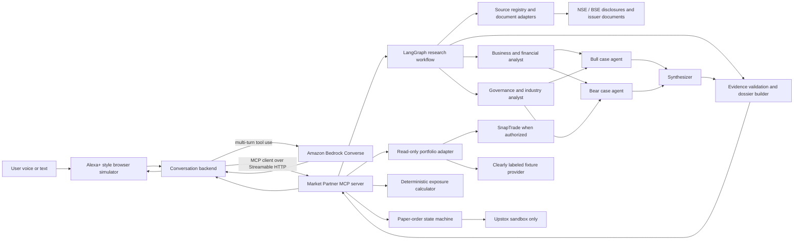

# Market Partner system architecture

**Design baseline: 10 October 2026**
**Primary track: Alexa+**
**Status: MVP architecture and detailed use-case design baseline; application code not started**

## Product definition

Market Partner is a voice-led, sourced research and portfolio workspace for self-directed investors. The full product target has four workflows: portfolio intelligence (holdings, performance and broker-published research); company research and discovery (multi-company research, saved-dossier comparison and user-defined screening); watchlist monitoring with event alerts; and a paper-trading lifecycle (preview, explicit confirmation, status, modification and cancellation).

The hackathon build is a deliberately narrow slice of this target. It researches one selected Indian listed company from a bounded packet of dated disclosures, returns a source-linked brief with the strongest supported case and countercase, calculates how a user-specified quantity changes exposure, and previews/submits a user-confirmed paper order to the Upstox sandbox. The MVP boundaries are detailed below; the broader target is captured in [`USE_CASES.puml`](USE_CASES.puml).

The system does not choose stocks, recommend an action, size a position, or send a live order. The user owns the investment decision. This boundary matters both for the product's trust model and for Alexa+ financial add-on policy, which prohibits directive investment advice and imposes extra institution authorization and transaction safeguards for publication. [10]

## Full product target and staged scope

The use-case model groups product value into four workflows:

1. **Portfolio intelligence:** review linked holdings and portfolio metrics; inspect trade history, account activities, calculated performance, and separately labeled broker research; connect or revoke linked accounts.
2. **Research and discovery:** investigate selected companies; save and compare dossiers; screen a user-selected universe against visible sector or user-defined criteria.
3. **Monitoring:** configure a watchlist, alert rules and delivery preferences; scan for new material evidence; let users review alerts and optionally receive email or push notifications.
4. **Paper trading:** calculate hypothetical exposure, preview an order, explicitly confirm it, then inspect status; allow separately confirmed modifications and cancellations where the sandbox supports them.

These are product goals, not all hackathon features. The MVP stays fixture-first for account data, focuses on one company at a time, and leaves performance analytics, broker research feeds, screening, scheduled monitoring/notifications, and order modification/cancellation for later. MVP persistence stores a validated research-run snapshot for provenance; UC-11's reusable, user-managed saved-dossier library is later-phase behavior. SnapTrade account activities are daily refreshed, so any later history/performance screen must display data freshness and must not imply real-time activity. [12] Upstox currently lists sandbox support for place, modify and cancel order APIs, but sandbox coverage is phased and each exact endpoint/lifecycle must be verified before those actions are added. [13]

The expanded scope adds several design requirements for later phases:

- Keep broker-authored research in a separately attributed source lane; SnapTrade account connectivity does not imply access to a broker's research product.
- Let users revoke account connections and choose alert channels; keep account-link controls and notification consent visible in the product design.
- Store versioned dossiers with their source IDs, timestamps and content hashes so comparisons and alerts can explain what changed and why.
- Make screening criteria explicit and deterministic. The system can explain matches and missing data, but it must not convert screens into personalized buy recommendations.
- Monitoring must compare a new dated source with a saved dossier, suppress duplicate/immaterial alerts, and let the user review the supporting evidence.
- Performance metrics need transaction history, prices, fees, dividends and corporate-action handling. Report gaps and data timestamps instead of implying precise returns from incomplete broker activity.
- Treat order modification and cancellation as new confirmed actions tied to the exact current sandbox order state, with idempotency and clear status reporting.

## What we are carrying forward from marketsearch

The local `marketsearch` project has useful deterministic foundations and a thoughtful proposed agent design. Its implemented areas include an India-specific point-in-time data store, security and corporate-action handling, financial calculations, a screen, and a validation harness. Its design spec proposes a data-first research workflow, functional analyst roles, independent bull/bear review, structured claims, and a synthesizer that must address the bear case.

The agent pipeline itself is **not implemented there yet**: `Agent` is marked as a future LangGraph node, and `research(ticker)` raises `NotImplementedError`. The existing deterministic `decision_hub.decide()` returns `BUILD`, `NIBBLE`, `WATCH`, or `SKIP`; that output belongs to marketsearch's personal portfolio workflow and will not be reused as a user-facing decision in Market Partner. The existing `Thesis` model also expects valuation, conviction, position horizon and claims fields that exceed the hackathon MVP.

We will reuse the design principles, then implement a smaller, purpose-built workflow in this repository. We will not copy the full marketsearch engine into the hackathon project. In particular, its local market data snapshot ends on 1 September 2026 and its gap register says fundamentals and company-announcement ingestion are incomplete. It cannot be treated as a fresh research source without new source retrieval and date checks.

### Principles retained

1. **Evidence before analysis.** Normalize the source packet and mark missing or conflicting data before the analysts run.
2. **Models reason; code computes.** Models may explain evidence and uncertainty. Code resolves symbols, checks citations, calculates account exposure and validates order fields.
3. **Independent disagreement.** Bull and bear agents receive the same verified evidence without seeing one another's answer before producing their first draft.
4. **Claims remain falsifiable and traceable.** Keep each research assertion linked to one or more source records.
5. **No false precision.** No generated target price, return estimate or conviction score in the MVP.

## Hackathon delivery model

The official hackathon accepts an Alexa+ Agent Skill or a self-hosted MCP server using MCP protocol version 2025-11-25 or later over Streamable HTTP; it also allows a simulated Alexa+ web experience using the entrant's agentic tools. The Alexa+ Category SDK, MCP Toolkit, CLI and Web Simulator are gated to selected partners, and participants cannot connect the project to a real Alexa+ device. We will use the strongest verifiable path: a real MCP server and our own web conversation host. For this submission, pin the server/client contract to 2025-11-25 and demonstrate `initialize`, `tools/list`, and `tools/call` over Streamable HTTP at runtime; treat a later protocol revision as a separately reviewed migration. [2][3]

The public demo will use the browser simulator and fixture account data by default. If authorized test brokerage access is available, the video may show masked live read-only holdings, clearly labeled as such. The source code and README must retain a no-credential fixture path so judges can reproduce the experience.

## System diagram

The [high-level design](HLD.md) provides the corresponding C4 context, container and component views, plus the detailed sequences for research, current portfolio exposure, confirmed paper orders and later-phase monitoring.



The research graph is invoked through the `research_company` MCP tool. Bedrock Converse is the conversation host: it interprets the user's request, calls the MCP tools, and formats the final short spoken answer and supporting cards. The Bedrock conversation host and the analyst graph are separate on purpose: the conversation layer handles user intent and tool selection; the research graph handles the controlled evidence workflow. Bedrock Converse supports multi-turn conversation and client-side tool use. [4]

## Chosen implementation stack

| Layer | Choice | Why it fits this build |
|---|---|---|
| Web experience | React + TypeScript + Vite | Fast to iterate on a focused simulator; speech input has a visible text fallback. |
| Voice I/O | Browser speech recognition and speech synthesis, with typed input always available | Demonstrates a voice-led turn without implying native Alexa+ hardware. Audio stays in the browser; the backend receives the recognized text. |
| Application API | Python + FastAPI + Pydantic | Reuses the team's Python familiarity and makes tool contracts explicit. |
| Agent workflow | LangGraph, with parallel specialist/adversarial nodes and structured outputs | Makes agent roles, state transitions and evidence flow inspectable. |
| MCP | Official MCP Python SDK, Streamable HTTP transport | Exposes task-level tools through a real protocol endpoint that the browser host calls at runtime. Pin a patched SDK release and verify negotiation against the required protocol version before submission. |
| Model access | Amazon Bedrock Converse, selected model configured by environment | Keeps the conversation and research calls on one controlled provider; model choice can be changed without changing the graph contract. |
| Local persistence | SQLite plus versioned local fixtures | Sufficient for a single-user judging demo, run history, source metadata and expiring order previews. Secrets stay outside the database. |
| Portfolio adapter | Fixture provider first; SnapTrade only if access is approved | Preserves the complete demo without depending on brokerage authorization. |
| Paper execution | Upstox sandbox adapter only | Shows a confirmed end-to-end order lifecycle without real money or production order access. |

The first implementation should be one Python service with `/api/chat` and a real `/mcp` Streamable HTTP endpoint, plus the Vite web client. The conversation backend must call tools through its MCP client, even when the MCP server runs in the same local deployment; this keeps the demo honest about protocol use and leaves a clean service boundary. Secrets and provider URLs come from environment configuration. The judge path uses fixtures and does not require AWS or broker credentials; live Bedrock and sandbox paths are configured separately for the recorded team demo.

Planned repository layout:

```text
apps/web/                 React + Vite simulator
apps/server/              FastAPI app, conversation host, MCP server
  market_partner/agents/  LangGraph state, nodes and prompts
  market_partner/tools/   research, portfolio, exposure and paper-order tools
  market_partner/data/    source adapters and typed contracts
fixtures/                 source packet, portfolio and model-response fixtures
docs/                     architecture, decisions and submission materials
```

## Component responsibilities

| Component | Responsibility | Must not do |
|---|---|---|
| Browser simulator | Voice/text input, short spoken response, source cards, exposure view, explicit order preview and confirmation. | Imply it is a real Alexa+ device or display unmasked account details. |
| Conversation backend | Hold a short-lived conversation, use Bedrock Converse to select MCP tools, present tool results and retain selected company/context. | Invent research facts or convert the user's question into an unsolicited trade recommendation. |
| MCP server | Provide typed, discoverable tools over Streamable HTTP; validate inputs; call research, account and order services. | Expose live trading tools in this MVP. |
| Research graph | Run source validation, specialist analysis, bull/bear review and synthesis with typed state. | Emit an unconstrained BUY/HOLD/SELL decision. |
| Source registry | Store issuer, source type, URL, document date, retrieval time, relevant excerpts and checksum. | Treat a public URL as permission for unrestricted bulk scraping. |
| Portfolio provider | Retrieve read-only positions from an authorized provider or return a labeled fixture. | Send brokerage credentials to a model or let an LLM calculate totals. |
| Exposure calculator | Compute current and hypothetical name/sector exposure from holdings and user-entered quantity/price. | Recommend a quantity or call an order API. |
| Paper-order service | Validate, preview, confirm and submit paper orders to the Upstox sandbox. | Reach any live endpoint or infer confirmation from conversational enthusiasm. |

## Multi-agent research workflow

Use LangGraph `StateGraph` as the workflow engine. It gives us explicit nodes, shared typed state, independent branches and a visible execution path. LangGraph's own guidance treats a graph as discrete nodes connected through state; independent analyst nodes can execute in parallel and then converge on synthesis. [5]

### Run stages

1. **Resolve the company.** Map a user phrase to a listed security using a deterministic company directory. If the symbol is ambiguous, ask a clarifying question before research.
2. **Build the evidence packet.** Retrieve only the selected demo company's approved source set: exchange announcements, quarterly/annual filings and issuer investor-relations documents. Keep document dates and retrieval times. For the first demo, use one preselected company and a small source packet to reduce retrieval failures.
3. **Check evidence quality.** Reject malformed or undated sources, flag stale data and expose missing periods. Do not let the analysts imply the packet is complete if it is not.
4. **Run two specialist analysts in parallel.**
   - **Business and financial analyst:** describes business lines, operating trends, cash conversion, debt and customer/segment concentration only where the packet supports it.
   - **Governance and industry analyst:** looks for governance signals, material announcements, business context and external dependencies in the same evidence packet.
5. **Run two independent adversarial agents in parallel.**
   - **Bull agent:** states the strongest case supported by the evidence.
   - **Bear agent:** actively searches for counterevidence, failed assumptions and facts that could change the user's thesis.
   Each agent sees the verified sources and its assigned role, but not the other adversary's first answer.
6. **Synthesize a dossier.** A synthesizer groups agreements and disagreements, cites only claim/source IDs already in the packet, and states important unknowns. It does not pick a winner or recommend an action.
7. **Validate deterministically.** The validator checks that each material claim has valid evidence IDs and dates, that reported facts are not presented as calculations, and that unsupported numbers or directive investment language are blocked or marked for correction.
8. **Return structured output.** The MCP tool returns both concise text and a structured dossier for the interface. The conversation layer creates a brief voice response while the browser shows the complete source trail.

This yields five model roles per research run: two specialists, bull, bear and synthesizer. Source retrieval, company matching, financial arithmetic, citation validation and portfolio calculations are deterministic functions, not LLM agents. We should not add a free-roaming “researcher” agent that can browse arbitrary sites in the MVP.

## Research data contract

All run state and tool results use structured records. Initial schema:

```text
SourceRecord
  source_id, issuer, ticker, source_type, title, url
  published_at, retrieved_at, content_hash, excerpt_ids

EvidenceClaim
  claim_id, statement, claim_kind
  evidence_ids[], status: supported | contradicted | mixed | unknown
  value?, unit?, as_of_date?, calculation_method?

AgentAnalysis
  role, summary, claim_ids[], counterpoints[], open_questions[]

ResearchDossier
  ticker, question, generated_at, source_ids[]
  supported_case[], countercase[], disagreements[], unknowns[]

PortfolioSnapshot
  provider, account_label_masked, fetched_at, currency
  positions[{ticker, quantity, market_value, source_timestamp}]

PaperOrderPreview
  preview_id, ticker, exchange, side, quantity, limit_price
  estimated_value, account_alias, mode=sandbox, expires_at, status
```

`claim_kind` is one of `reported_fact`, `calculation`, or `interpretation`. Every calculation carries its input evidence IDs and method. The LLM cannot change a calculated balance, price or exposure percentage by rewriting text; the returned narrative must use the values in the structured result.

## MCP tool surface

The interface should expose a small number of task-level tools. `research_company` is deliberately a multi-step workflow, not a thin wrapper around one existing API.

| Tool | Input | Output / guard |
|---|---|---|
| `resolve_company` | company phrase | Candidate listed companies; asks for clarification if ambiguous. |
| `research_company` | ticker, user question, optional source window | Research dossier, source metadata, unknowns and run ID. No recommendation field. |
| `get_portfolio_exposure` | ticker, optional sector, provider profile | Combined exposure with per-provider freshness and data-mode labels. Read-only. |
| `preview_paper_order` | ticker, exchange, buy/sell, user quantity, user limit, sandbox account alias | Full order preview and post-order exposure. Creates no order. |
| `confirm_paper_order` | preview ID plus explicit confirmation | Submits only the unexpired preview to Upstox sandbox; idempotent for the same preview. |
| `get_paper_order_status` | sandbox order ID | Current sandbox status and timestamp. |

Do not expose a generic `place_order` tool or any live trading flag in the MVP. Confirmation must refer to an exact preview, and changing ticker, quantity, side, account or price invalidates the preview and requires a new confirmation.

## Portfolio data and order execution

### Portfolio reading

Create a `PortfolioProvider` interface with two implementations:

- **Fixture provider:** included in the repo and used by default in judging. Every account and balance is visibly labeled sample data.
- **Authorized provider:** SnapTrade Personal for the team's own consenting brokerage accounts, or a separate commercial test setup if approval is available. SnapTrade's hosted Personal MCP is read-only; the partner API is a distinct integration path. The broker access guide lists Upstox and Zerodha as read-only and says production access is subject to application approval. [6][7]

Never assume approval will arrive in time. The fallback should still demonstrate the research workflow, deterministic exposure arithmetic and Upstox sandbox order. Do not claim two live broker connections unless the demo actually shows both.

### Paper-order state machine

```text
NONE -> DRAFT -> PREVIEWED -> USER_CONFIRMED -> SUBMITTING -> SUBMITTED_SANDBOX -> STATUS_RECEIVED
                    |                           |                  |
                    +-> EXPIRED / CANCELLED     +-> REJECTED       +-> SUBMISSION_UNKNOWN
                                                +-> FAILED_BEFORE_SUBMIT
```

The order service accepts only `mode=sandbox`; the sandbox URL/credentials are configured separately from any live brokerage tokens. The confirmation step checks preview expiry and an idempotency key before it submits. The user sees ticker, exchange, side, quantity, limit price, estimated value, account alias and the text “Paper order — no real money” before confirming. Upstox documents a sandbox for order lifecycle testing without funds; the exact sandbox-enabled endpoint and token need to be confirmed in the team's account before implementation is locked. [8]

## State, storage and trust boundaries

- Keep the conversation transcript and selected company in a short-lived session store. Use an opaque `thread_id`; do not put names, account numbers or credentials in graph state.
- Persist source records and research run IDs so a displayed claim can be reopened. Cache only public/licensed documents and fixture data for the demo.
- Keep raw broker tokens in environment-backed server secrets. Never send credentials, account numbers or full names to Bedrock, the browser, logs or the Git repository.
- Give the model only the minimum portfolio summary needed to answer the user's question. Perform totals and exposure calculations in code.
- Treat retrieved filing text as untrusted data, never as instructions to the agent. Cap document size and source count; each run receives a small, bounded packet.
- For judges, the fixture mode must work without connecting a real brokerage. The demo video may use masked test data, but no user credentials or private statements should be published.

## Hackathon MVP and non-goals

### MVP

- One Indian cash-equity company at a time, chosen by 12 October after verifying usable official sources.
- A small source packet with source dates and clickable citations.
- Two parallel specialist agents, independent bull/bear agents and a constrained synthesizer.
- Voice input with text fallback, short spoken output and an evidence-rich browser card view.
- Read-only cross-account exposure, using real authorized data only if available; otherwise fixture mode.
- Deterministic hypothetical exposure update for a user-entered quantity and limit price.
- Upstox sandbox order preview, separate confirmation, order ID and sandbox status.
- Working MCP server using Streamable HTTP pinned to protocol 2025-11-25; the demo must show runtime use, not just name the protocol in the README. [1][2]

### Explicit non-goals for this entry

- Universal multi-broker trading or any live order placement.
- “AI financial advisor,” buy/hold/sell labels, personalized stock picks, return promises or autonomous order placement.
- A market-wide scanner, portfolio construction, conviction score, position-sizing engine or backtest.
- Derivatives, intraday trading, alerts, continuous monitoring, social sentiment ingestion or a full tax engine.
- Portfolio performance history, broker-published research feeds, universe screening, saved-dossier comparison, scheduled monitoring/notifications, and paper-order modification/cancellation.
- Production Alexa+ certification, real Alexa+ device integration or production-scale multi-user account linking.

The long-term bridge to the original marketsearch work is a versioned thesis journal with falsifiable claims and scheduled evidence refresh. It belongs after the competition, once the evidence workflow and access model are proven.

## Acceptance criteria for an architecture-complete demo

1. A judge can start fixture mode from the repo instructions without personal broker credentials.
2. The browser host calls a running MCP endpoint over Streamable HTTP; at least one research run invokes the analyst graph at runtime.
3. The dossier displays at least two dated primary sources and clickable claim-level citations.
4. The bull and bear sections cite evidence IDs from the same verified source packet and include meaningful disagreement or unknowns.
5. Changing a user-entered quantity updates hypothetical exposure through deterministic code.
6. Cancelling or failing to confirm a paper preview submits no order; confirming one unexpired preview produces a sandbox order identifier/status.
7. Every displayed account, document, price and order field is labeled with its source and freshness or marked as a fixture.
8. No path can call a live order endpoint from the MVP.

## Implementation gates

| Gate | Decision to verify | Deadline |
|---|---|---|
| Account access | Can SnapTrade authorize the team's own Upstox/Zerodha accounts? If not, fixture remains the judging path. | 12 Oct |
| Paper order | Can the team's Upstox sandbox credentials place and read a sandbox order for the selected instrument? | 12 Oct |
| Evidence packet | Which one company has enough recent, official disclosures for a balanced case? | 12 Oct |
| Model runtime | Can Bedrock access be configured and cost-capped for the five-role workflow? Keep a deterministic fixture response for development fallback. | 12 Oct |
| Freeze | No new data sources or feature branches after the demo's one-company flow is stable. | 18 Oct |

## Primary technical and policy references

1. [Build, Ship, Shape official rules](https://amazonappdev2026.devpost.com/rules)
2. [Build, Ship, Shape FAQ](https://amazonappdev2026.devpost.com/details/faqs)
3. [Official Model Context Protocol Python SDK](https://github.com/modelcontextprotocol/python-sdk)
4. [Amazon Bedrock Converse API and tool use](https://docs.aws.amazon.com/bedrock/latest/userguide/conversation-inference.html)
5. [LangGraph workflow design guidance](https://docs.langchain.com/oss/python/langgraph/thinking-in-langgraph)
6. [SnapTrade getting started](https://docs.snaptrade.com/docs/getting-started)
7. [SnapTrade broker access guide](https://docs.snaptrade.com/docs/broker-access-guide)
8. [Upstox sandbox documentation](https://upstox.com/developer/api-documentation/sandbox/)
9. [NSE corporate announcements](https://www.nseindia.com/companies-listing/corporate-filings-announcements)
10. [Alexa+ financial services and transactions policy](https://developer.amazon.com/docs/alexaplus/add-ons/policy-requirements.html)
11. [SEBI investment adviser FAQ](https://www.sebi.gov.in/sebi_data/faqfiles/aug-2025/1755174193178.pdf)
12. [SnapTrade: list account activities and data refresh cadence](https://docs.snaptrade.com/reference/Account%20Information/AccountInformation_getAccountActivities)
13. [Upstox sandbox and sandbox-enabled order APIs](https://upstox.com/developer/api-documentation/sandbox/)
