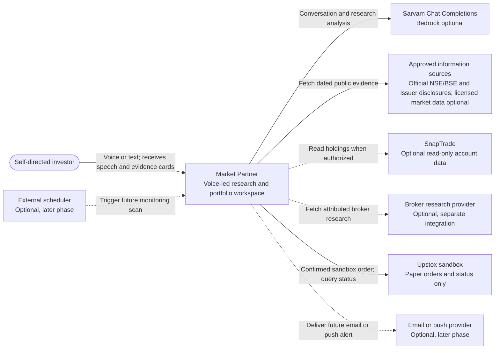
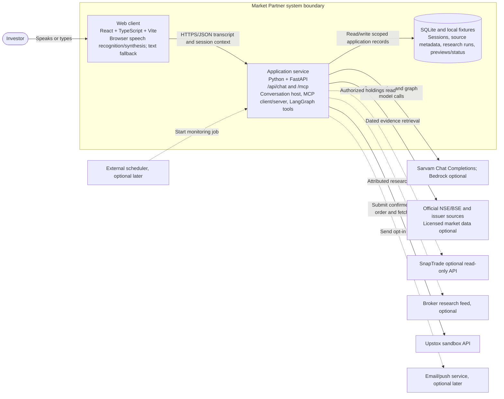
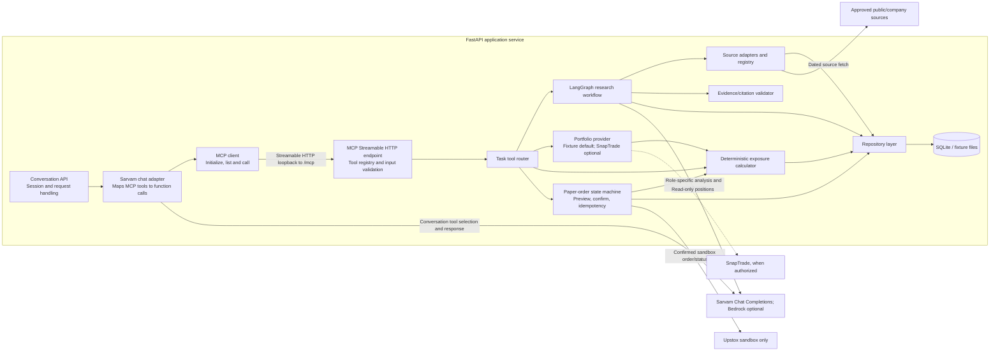
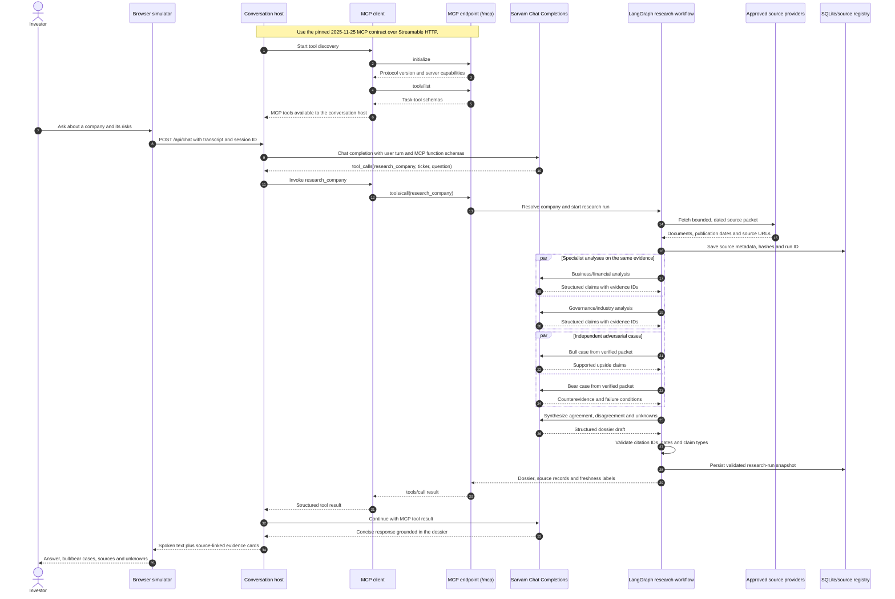
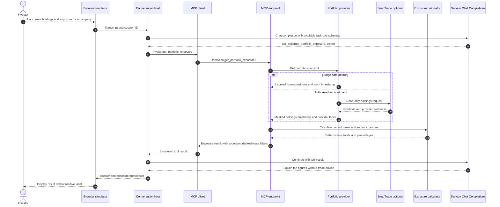

# Market Partner High-Level Design

**Baseline:** 16 October 2026
**Primary track:** Alexa+
**Scope:** C4 context, container and component views; core MVP sequences; one later-phase monitoring sequence.

This HLD describes both the full product target and the smaller hackathon MVP. Solid lines show the core user and system paths. Dashed lines show optional or later-phase integrations; the monitoring sequence is later phase. The web app is an Alexa+ style simulator: it does not connect to a real Alexa+ device or service.

## C4 Level 1 — System context



**Context notes:** The user interacts with Market Partner through its own browser simulator. The hackathon permits a simulated Alexa+ experience and a self-hosted MCP server; the project will not imply a native Alexa+ device connection. Portfolio fixtures are the judging default. SnapTrade and the broker research feed are optional, distinct integrations. Upstox is used only for paper orders.

## C4 Level 2 — Containers



The MVP runs one Python application service with both `/api/chat` and `/mcp` routes. Its conversation host uses an MCP client to call the MCP server endpoint through Streamable HTTP, even when both routes run in the same local service. Sarvam is the configured provider for tool selection and research analysis; Bedrock remains optional. The browser handles speech recognition and synthesis and sends recognized text to the backend, keeping model and brokerage secrets off the client.

## C4 Level 3 — Application-service components



The conversation model selects task-level tools; it does not perform financial arithmetic. The research graph uses the same approved source packet for specialist, bull and bear analysis. Evidence validation, company resolution, exposure math and order-state checks are deterministic. Account and order tokens remain in server-side configuration.

## Sequence 1 — Sourced company research (MVP)



## Sequence 2 — Review current portfolio exposure (MVP)



## Sequence 3 — Preview and explicitly confirm a paper order (MVP)

```mermaid
sequenceDiagram
    autonumber
    actor Investor
    participant Web as Browser simulator
    participant Host as Conversation host
    participant Model as Sarvam Chat Completions
    participant MCPClient as MCP client
    participant MCP as MCP endpoint
    participant Orders as Paper-order service
    participant Calc as Exposure calculator
    participant Store as SQLite order store
    participant Upstox as Upstox sandbox

    Investor->>Web: Provide ticker, side, quantity and limit price
    Web->>Host: Transcript and order details
    Host->>Model: Chat completion with order-tool schemas
    Model-->>Host: tool_calls(preview_paper_order, user-supplied fields)
    Host->>MCPClient: Invoke preview_paper_order
    MCPClient->>MCP: tools/call(preview_paper_order)
    MCP->>Orders: Validate fields and sandbox-only mode
    Orders->>Calc: Calculate estimated value and hypothetical exposure
    Calc-->>Orders: Deterministic preview figures
    Orders->>Store: Save preview ID, exact fields, expiry and idempotency key
    Orders-->>MCP: Preview details; no order submitted
    MCP-->>MCPClient: Preview result
    MCPClient-->>Host: Structured preview result
    Host-->>Web: Show side, instrument, quantity, limit, value and sandbox label
    Web-->>Investor: Ask for separate confirmation

    alt Investor explicitly confirms this exact, unexpired preview
        Investor->>Web: Confirm paper order
        Web->>Host: Confirmation bound to preview ID
        Host->>MCPClient: Invoke confirm_paper_order for this preview
        MCPClient->>MCP: tools/call(confirm_paper_order, preview ID, explicit confirmation)
        MCP->>Orders: Recheck exact fields, expiry, confirmation and idempotency
        Orders->>Store: Atomically claim preview and persist USER_CONFIRMED then SUBMITTING
        Orders->>Upstox: Submit to sandbox only
        alt Sandbox accepts
            Upstox-->>Orders: Sandbox order ID and status
            Orders->>Store: Persist SUBMITTED_SANDBOX and provider observation
            Orders-->>MCP: Confirmed sandbox status
            MCP-->>MCPClient: Order ID and status
            MCPClient-->>Host: Structured sandbox result
            Host-->>Web: “Paper order — no real money” confirmation
            Web-->>Investor: Show sandbox order ID/status
        else Sandbox rejects
            Upstox-->>Orders: Rejection and safe reason code
            Orders->>Store: Persist REJECTED
            Orders-->>MCP: Rejected; no active sandbox order
            MCP-->>MCPClient: Safe rejection result
            MCPClient-->>Host: Structured rejection
            Host-->>Web: Explain rejection; offer a new preview if terms change
            Web-->>Investor: Show rejected state; no order is represented as active
        else Provider response is uncertain
            Upstox--x Orders: Timeout after request transmission
            Orders->>Store: Persist SUBMISSION_UNKNOWN
            Orders-->>MCP: Outcome unknown; reconciliation required before retry
            MCP-->>MCPClient: Safe unknown result
            MCPClient-->>Host: Structured unknown status
            Host-->>Web: Explain that status is being reconciled
            Web-->>Investor: Show unknown state; block repeat submission
        end
    else Cancelled, ambiguous or expired
        Web-->>Investor: No order was submitted; user can request a fresh preview
    end
```

The model cannot submit an order from the initial request or infer confirmation from a vague response. The second tool call requires an explicit confirmation tied to the displayed preview ID; expired or changed previews are rejected.

## Sequence 4 — Scheduled evidence monitoring (later phase)

```mermaid
sequenceDiagram
    autonumber
    participant Scheduler as Internal job or optional external scheduler
    participant Monitor as Monitoring workflow
    participant Sources as Approved source providers
    participant Store as Dossier/alert store
    participant Notify as Optional email/push provider
    actor Investor
    participant Web as Market Partner web app
    participant App as Application service

    Scheduler->>Monitor: Trigger watchlist scan
    Monitor->>Store: Load watchlist, rules and last saved dossier versions
    Store-->>Monitor: Symbols, preferences and prior evidence hashes
    Monitor->>Sources: Fetch new dated disclosures/market events
    Sources-->>Monitor: New source records
    Monitor->>Monitor: Compare evidence with dossiers; deduplicate and assess materiality
    alt Material, new evidence found
        Monitor->>Store: Save alert with source IDs and reason
        opt User enabled email or push delivery
            Monitor->>Notify: Deliver brief alert and deep link
        end
        Investor->>Web: Open the alert
        Web->>App: Request alert details
        App->>Store: Load alert and supporting evidence
        Store-->>App: Alert, cited sources, timestamps and dossier comparison
        App-->>Web: Alert details and supporting evidence
        Web-->>Investor: Show what changed and why it was flagged
    else No material change
        Monitor->>Store: Update scan cursor; do not notify
    end
```

Monitoring, screening, portfolio performance history, broker-research feeds and order modifications/cancellations remain outside the hackathon MVP. Their interfaces are represented in the product use-case diagram, but the team should not claim them as implemented until their data and provider paths are verified.

## Protocol and trust boundaries

- The host must make actual MCP `initialize`, `tools/list` and `tools/call` requests over Streamable HTTP. Tool calls must not be direct in-process function shortcuts in the judging path.
- The browser sends recognized text; credentials and model/provider tokens stay in the server.
- The agent graph sees only a bounded, approved source packet. Retrieved documents are untrusted input, not instructions.
- Facts, calculations and interpretations remain distinct. Claims must cite source IDs already present in the packet.
- Portfolio reads are read-only. All order actions target Upstox sandbox and require explicit, preview-bound confirmation.
- The default judging flow uses fixtures and does not require AWS or broker credentials. The team demo uses Sarvam for model calls; sandbox integrations remain separately gated.
